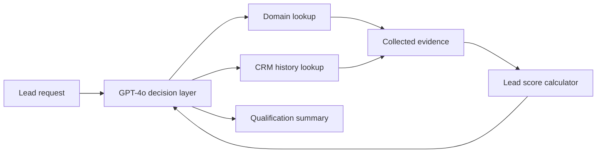

# 🧠 ReAct CRM Lead Qualification Agent

An autonomous CRM assistant for sales and revenue-operations teams that enriches inbound leads, checks prior CRM activity, assigns a qualification score, and produces a concise summary through an observable ReAct tool-calling loop.

---

## 1️⃣ Project Title & Value Proposition

**ReAct CRM Lead Qualification Agent for sales teams, turning raw lead emails into enriched, prioritized CRM insights.**

The agent reduces the repetitive work required to research a company, inspect its engagement history, apply qualification rules, and prepare a handoff-ready summary.

---

## 2️⃣ Background & Problem Context

Sales and revenue-operations teams frequently receive leads with little more than an email address. Before a representative can decide how quickly to respond, they must gather company information, search the CRM, interpret past engagement, and consistently apply scoring rules.

This process becomes difficult at scale because:

- Research and CRM lookup must be repeated for every lead.
- Qualification quality varies between team members.
- Manual handoffs introduce delays and missing context.
- Simple automations struggle to coordinate multiple data sources and explain the final decision.

The current notebook demonstrates the workflow with deterministic mock company and CRM data.

---

## 3️⃣ Target User & Job To Be Done (JTBD)

- **Primary user:** Sales Development Representative (SDR) qualifying inbound leads
- **Secondary users:** Account Executives, Sales Operations, and Revenue Operations
- **JTBD:** Enrich and prioritize an incoming lead consistently, with enough context for a representative to choose the appropriate next action.

---

## 4️⃣ Why an Agentic Approach (Very Important)

A fixed script can execute a known sequence, but this project demonstrates an agent that decides which tools to invoke, supplies their arguments, incorporates their outputs, and determines when enough evidence exists to return a final answer.

The agentic approach is useful because it can:

- Interpret a natural-language request and extract the lead’s email and company domain.
- Select and sequence tools based on the information available.
- Combine heterogeneous company and CRM records into a scoring request.
- Continue the reasoning-and-action loop until no further tool calls are needed.
- Generate a human-readable summary from structured evidence.

---

## 5️⃣ Agent Role, Scope & Autonomy Level

The agent autonomously owns the demonstrated qualification workflow:

1. Identify the company domain from the lead request.
2. Retrieve company information.
3. Check CRM history.
4. Combine the evidence and calculate a lead score.
5. Summarize the qualification result.

The prototype is advisory only. It prints its result and does not update a CRM, contact a lead, or trigger a sales workflow. Any production system should require human approval for customer-facing communication and other consequential actions.

---

## 6️⃣ Agent Architecture & Components

### a) Planner / Decision Layer

OpenAI `gpt-4o` receives the user request, tool definitions, prior messages, and tool results. It dynamically chooses the next function call or ends the loop with a final response.

### b) Executors / Tools

| Tool | Responsibility | Current implementation |
|---|---|---|
| `lookup_domain_info_v2` | Retrieves industry, employee count, and estimated revenue | In-memory mock data keyed by domain |
| `check_crm_history_v2` | Retrieves last contact, CRM status, and notes | In-memory mock data keyed by email |
| `calculate_lead_score_v2` | Assigns a High, Medium, or Low score | Deterministic Python rules |

### c) Memory

- **Session memory:** The OpenAI message list retains the prompt, assistant decisions, and tool responses for the current run.
- **Working state:** `collected_data` stores company and CRM results before scoring.
- **Long-term memory:** Not implemented; CRM records are currently mocked in Python dictionaries.

### d) Orchestration Logic

The `run_agent_with_detailed_tool_call` function implements the ReAct loop. It dispatches model-selected functions through `AVAILABLE_FUNCTIONS_V2`, returns each result as a tool message, and stops when the model responds without another tool call.



---

## 7️⃣ End-to-End Agent Workflow

1. A user submits a natural-language request containing a lead email.
2. The model extracts the company domain.
3. The model calls the domain-enrichment and CRM-history tools.
4. The orchestrator records both structured JSON responses.
5. The model requests a lead-score calculation.
6. The orchestrator supplies the combined evidence to the deterministic scorer.
7. The tool returns a `High`, `Medium`, or `Low` score.
8. The model produces a readable summary and the loop terminates.

All model tool calls, raw tool outputs, and tool messages sent back to the model are printed for inspection.

---

## 8️⃣ Tools, Models & Stack (With Rationale)

| Component | Technology | Rationale |
|---|---|---|
| Language | Python | Simple tool implementation and orchestration |
| Runtime | Google Colab/Jupyter | Interactive development and trace inspection |
| LLM client | OpenAI Python SDK | Structured function calling and chat orchestration |
| Model | `gpt-4o` | Natural-language interpretation, tool selection, and summarization |
| Configuration | `google.colab.userdata`, `python-dotenv` | Supports Colab secrets and local environment loading |
| Data exchange | JSON | Consistent structured communication between tools and the model |

---

## 9️⃣ Evaluation Strategy & Metrics

The included scenario qualifies `jane@acmecorp.com`. The agent successfully:

- Retrieved Acme Corp’s mock company profile.
- Found Jane’s mock CRM history.
- Assigned a **Medium** score using the configured rules.
- Produced a summary consistent with the tool evidence.

This is a functional demonstration, not a benchmark. A production evaluation should measure:

- **Tool-selection accuracy:** Was every required tool called without unnecessary calls?
- **Argument accuracy:** Were the correct email and domain supplied?
- **Scoring correctness:** Does the result match the approved scoring policy?
- **Groundedness:** Does every summary claim appear in tool evidence?
- **Latency and cost:** End-to-end duration, token usage, and cost per qualified lead
- **Human intervention rate:** Percentage of leads requiring correction or escalation

---

## 🔟 Guardrails, Trust & Safety

- Lead scoring is deterministic and separated from the language model.
- Raw tool calls and responses are logged for traceability.
- Unknown domains and emails return explicit fallback records.
- The prototype performs no external writes or customer-facing actions.
- Production logs should redact or encrypt personal information such as email addresses.
- Tool arguments, model outputs, and external API responses should be validated before use.
- A human should be able to override scores and review the evidence behind each decision.

---

## 1️⃣1️⃣ Failure Modes & Tradeoffs

- The enrichment and CRM tools use small mock datasets rather than live services.
- The scoring policy handles only a few revenue strings and one CRM status.
- The loop has no maximum-iteration limit, timeout, retry strategy, or exception handling around tool dispatch.
- A malformed model-generated JSON argument can terminate execution.
- An unknown function name can resolve to `None` and fail when invoked.
- Email and domain formats are not validated.
- Printed traces can expose lead data if logs are not secured.
- The implementation favors readability and observability over production resilience.

---

## 1️⃣2️⃣ Results, Learnings & Insights

The recorded test run shows the intended multi-step behavior. The model first requested company and CRM data, then requested scoring, and finally generated a grounded summary. Keeping scoring in deterministic Python makes the business policy easier to inspect and test while leaving language understanding and orchestration to the model.

The detailed trace also makes a key system behavior visible: qualification requires multiple model round trips. That improves flexibility but adds latency and cost compared with a fixed pipeline.

---

## 1️⃣3️⃣ Future Improvements & Iteration Plan

- Replace mock lookups with authenticated CRM and company-enrichment APIs.
- Move scoring thresholds into a versioned configuration or rules engine.
- Add Pydantic or JSON Schema validation for tool inputs and outputs.
- Add iteration limits, timeouts, retries, and graceful error handling.
- Implement structured final output for downstream CRM workflows.
- Add automated unit, integration, adversarial, and regression tests.
- Add tracing, token accounting, latency metrics, and privacy-aware observability.
- Introduce human approval before CRM writes, outreach, or escalation actions.
- Evaluate newer model options against quality, latency, and cost requirements.

---

## 1️⃣4️⃣ Demo & Artifacts

### Prerequisites

- Python 3
- An OpenAI API key
- The `openai` and `python-dotenv` packages
- Google Colab for the notebook’s current secret-loading implementation

### Run in Google Colab

1. Open `ReAct_CRM_Lead_Qualification_Agent.ipynb` in Google Colab.
2. Add a Colab secret named `OPENAI_APIKEY`.
3. Run the notebook cells in order.
4. Review the detailed tool trace and final qualification summary.

### Example

```python
run_agent_with_detailed_tool_call(
    "Please qualify this lead: jane@acmecorp.com"
)
```

Expected score for the included mock data: **Medium**.

> Never commit API keys or place them directly in the notebook.

---

## 1️⃣5️⃣ Role-Based Signal (Mandatory)

- **For PMs:** Demonstrates operational problem framing, explainable qualification rules, measurable outcomes, and human-control boundaries.
- **For EMs:** Demonstrates model/tool orchestration, separation of concerns, audit traces, and a clear path from prototype to production.
- **For SWEs:** Demonstrates JSON-based function calling, modular tool dispatch, deterministic business logic, and explicit reliability gaps to address.

---
